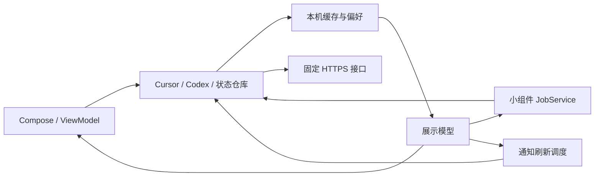

# 项目架构

agenT 是单模块原生 Android 应用，使用 Kotlin、Jetpack Compose 与 Material 3，没有自建后端。构建和原签名配置见 [build.md](../build.md)，产品入口见 [README](../README.md)。

## 工程边界

| 项目 | 当前配置 | 定义位置 |
| --- | --- | --- |
| 安装包与 namespace | `com.lamuier.agenT` | [app/build.gradle.kts](../app/build.gradle.kts) |
| 平台 | `minSdk=26`，`compileSdk=37`，`targetSdk=37`；Build Tools `37.0.0` | [app/build.gradle.kts](../app/build.gradle.kts) |
| 版本 | `versionName=1.2.0`，`versionCode=4`；后续增量记录在未发布条目 | [CHANGELOG](../CHANGELOG.md) |
| 工具链 | AGP `9.2.1`，内置 Kotlin `2.2.10`，Compose BOM `2026.08.00`，Gradle `9.5.1` | [版本目录](../gradle/libs.versions.toml)、[Wrapper](../gradle/wrapper/gradle-wrapper.properties) |
| Release | R8、资源压缩、仅 `arm64-v8a`；验证 ZIP 与 ELF 16 KiB 对齐 | [构建配置](../app/build.gradle.kts)、[构建校验](../scripts/build_support.py) |

## 目录职责

```text
agenT/
├── app/src/main/       生产 Kotlin、Android 资源与系统组件清单
├── app/src/debug/      仅 Debug 的验收 Activity 与样例数据
├── app/src/test/       JVM 测试与脱敏 JSON 样例
├── gradle/             依赖版本目录与固定 Gradle Wrapper
├── scripts/            构建实现、文档检查、静态预览与界面图库
├── docs/               架构、界面和通知的维护说明
├── build.sh / build.ps1 标准构建入口
└── build.md            统一构建指南
```

根目录的 `settings.gradle.kts` 定义单模块与依赖镜像，`build.gradle.kts` 声明插件，`gradle.properties` 定义构建进程参数；`gradlew.bat` 供 Windows 入口调用 Wrapper。`lint.xml` 仅保留自适应图标限定符的例外，`app/proguard-rules.pro` 保留注解属性。`.gitignore` 排除本机文件，`.gitattributes` 保证 Unix 脚本使用 LF，避免 Windows checkout 改写换行后无法运行。

Kotlin 根包是 `app/src/main/java/com/lamuier/agenT`：

| 位置 | 职责与主要入口 |
| --- | --- |
| 根包 | `AgenTApplication` 管理应用协程、语言迁移和小组件预览；`MainActivity` 管理主题、通知权限及外部跳转 |
| `ui/`、`ui/theme/` | `AgenTApp` 组合页面和安全面板；`DashboardScreen` / 五个页签展示状态；`SettingsSheet` 分类设置；主题、动效、折痕与触感集中维护；折叠分区和内存 Token 草稿见 [折叠屏适配](foldables.md) |
| `data/` | Cursor 仓库、加密账号 / 用量 / 任务缓存、双服务公开状态仓库，以及主题、导航、通知和触感偏好 |
| `network/` | 固定 Cursor / 官方状态端点的 HTTP 客户端、JSON 解析、用量组装与 Codex 组件范围筛选 |
| `codex/` | Codex 凭据、额度、刷新策略、重置券与本机历史、匿名公共重置记录和日历分桶 |
| `model/` | 跨页面的数据模型、稳定页签 ID、Token 表单与快捷入口规则 |
| `notification/` | 额度 / 重置提醒去重、任务观察、状态聚合、文案映射、原生通知和小米超级岛适配 |
| `widget/` | 七个 provider、RemoteViews、主题与位图预算、预览，以及共用 JobService 刷新 |
| `system/` | 概览快捷设置磁贴；它打开应用，不在磁贴服务中查询账号 |
| `util/` | 语言与时区、用量和任务显示、允许的外链、设备解锁及敏感内容保护 |
| `qa/` | Debug 验收临时偏好的恢复工具；实际验收 Activity 和 `ReviewFixture` 位于 Debug 源集 |

资源按 Android 限定符分层：默认中文与 `values-en` 英文；`values-night*` 夜间配色；`*-v31` 小组件系统配色 / 预览；`xml-v37` 网络配置。`mipmap-anydpi-v26` 保留自适应图标所需的 API 限定符，不能因 minSdk=26 就视作重复文件。Manifest、widget provider 名称和已保存偏好 ID 属于兼容契约。

## 数据与刷新



前台刷新由 `AgenTApp` 与 ViewModel 管理，通常五分钟一次；恢复前台时检查新鲜度，Codex 临近重置安排额外检查。小组件与常驻通知各有约十五分钟的 JobScheduler 调度。系统节电和网络条件可能延迟后台任务；到点只触发检查，不代表额度已经恢复。

`ServiceStatusRepository` 按服务维护缓存与在途请求。Cursor 用量按账号和凭据修订号隔离；Codex 凭据、用量与重置历史共用 `CodexStorageLock`，Cursor 账号读改写共用进程锁。所有系统组件与应用使用同一进程，避免多进程 SharedPreferences 覆盖。

「自动更新 Codex 用量」默认开启；关闭后前台轮询、后台通知及小组件自动路径跳过 Codex 用量，手动刷新和保存 Token 仍查询。仅放状态小组件时不查询用量。失败可回显缓存，但不得当作新鲜成功、补发提醒或触感确认。

## 接口与安全边界

| 数据 | 当前源码实际请求 | 凭据 |
| --- | --- | --- |
| Cursor 用量、计划、限额、Token 汇总与 Grok Bot 周额度 | `api2.cursor.sh/aiserver.v1.DashboardService/*` | Cursor Bearer |
| Cursor 账号与任务列表 | `cursor.com/api/auth/stripe`、`cursor.com/api/background-composer/list` | Cursor 会话 |
| Codex 当前额度窗口 / 重置券字段 | `chatgpt.com/backend-api/wham/usage` | Codex Bearer，可选 Account ID |
| 官方可用状态 | `status.cursor.com/api/v2/{summary,incidents}.json`、`status.openai.com/api/v2/{summary,components,incidents}.json` | 无 |
| 公共重置公告 / 观测 | `codex-resets.com/api/v1/resets` | 无 |

这些是代码中使用的通道，不代表服务方承诺长期稳定的公共 API。Codex 状态仅筛选 Codex Web / API / CLI / 桌面 / 扩展相关组件；缺少完整组件时显示未知，其他 OpenAI 产品的事件不直接归为 Codex 故障。

凭据、账号别名、用量、任务与个人重置历史经 Android Keystore AES-GCM 加密；公开状态和公共重置缓存明文保存。Keystore 的硬件保护取决于设备，应用不保证所有设备使用硬件密钥。默认不允许备份、设备迁移和明文连接；客户端拒绝重定向，响应大小受限。解锁查看、敏感剪贴板与 `FLAG_SECURE` 见 [隐私政策](../PRIVACY.md)。

应用内外链由 [CursorCustomTabs](../app/src/main/java/com/lamuier/agenT/util/CursorCustomTabs.kt) 调用允许列表校验，再交给系统浏览器；浏览器自己的登录态不等于应用 Token。公共重置链接和官方状态链接有独立校验规则。详细规则应直接维护在相应源码与测试，避免文档复制 URL 正则后失去同步。

重置页、概览计数和热力图仅使用公共 API 的 `regular` 普通重置与 `banked` 重置券发放记录，分别计数，不将发放记录数当成券数量或余额。来源仍区分原帖公告与第三方观测，以 API 分类为准，不按文案或余额变化猜测。新响应、缓存、统计及日历都保留这两类；按 API 分页信息继续查询，接口缺失不显示为已确认零次。缓存 schema 升为 2，兼容读取 schema 1；旧缓存可能筛掉过 `banked`，因此首次刷新绕过新鲜度复用且不发送旧 ETag，完整成功后才写入新缓存。公共查询最多五页，保留分页、ETag 和限流退避。

用量同步只覆盖保存最新窗口观察快照，供独立的窗口重置提醒比较；不再追加窗口到期刷新、提前变化、余额或券事件历史。旧个人历史保持加密存储兼容但不展示，订阅月起始日继续复用；删除 Codex 凭据会删除全部私有历史与观察快照。公共缓存最多 500 条，不计入账号使用次数，重置页不执行兑换。

当前仅支持**重置历史热力图**。应用没有每日使用量采集器、app-server 客户端或导入桥接；限额百分比与重置时间不能推算成真实每日 Token 使用量。缺失与失败也不能写成零。

## 测试与本机文件

`app/src/test` 覆盖解析、计算、语言 / 资源、缓存身份、通知状态与去重、小组件布局及 Compose 交互 / 渲染；JSON fixture 不含私人凭据。`app/src/debug` 保留非导出的验收入口，凭据检查使用独立偏好与密钥，临时主题、语言和时区可恢复。Debug 源集代码不会进入 Release，标准构建会检查这一边界。

`scripts/build_support.py` 是 Unix 构建入口的实现；`scripts/tests` 验证其环境、签名和失败处理。图库和两份 Node / sharp 预览脚本只生成本机验收文件，不是应用运行依赖。静态预览与系统行为的区别见 [界面验收](ui.md#界面验收)。

`.gradle/`、`.kotlin/`、`app/build/`、`dist/`、Python 缓存和本地工具缓存不入库；签名资产、`local.properties` 和本地 `AGENTS.md` 也不入库。历史改写备份 bundle 是可恢复备份，不属于可随意删除的构建垃圾。当前界面截图与原签名 APK 是验收 / 安装产物，应按用途保留，不与源码文档混在一起。
